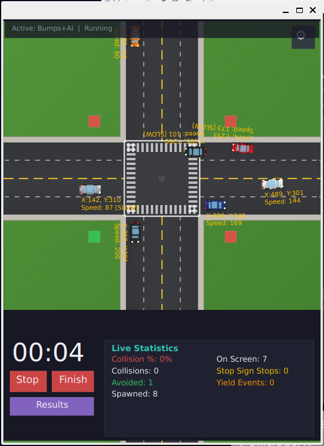
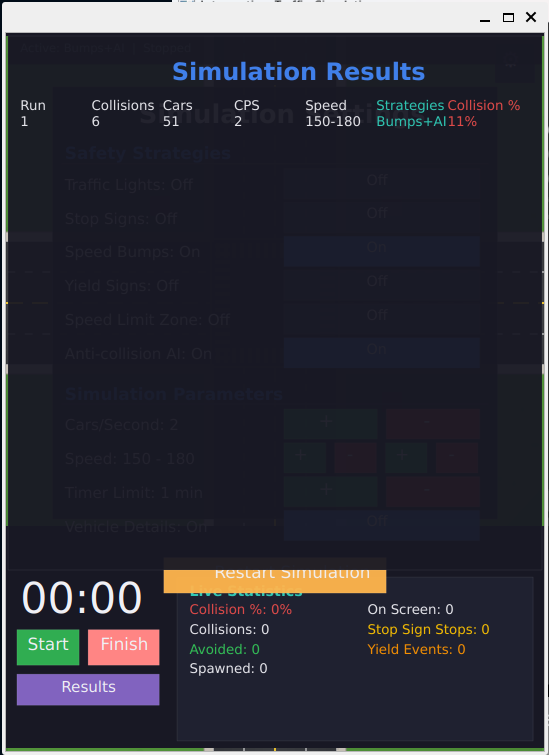

<h1 align="center">🚦 Intersection Traffic Simulation</h1>

<p align="center">
  <strong>A real-time traffic simulation for experimenting with collision-reduction strategies at an intersection</strong>
</p>

<p align="center">
  
  
  
  
</p>

---

## Overview

Vehicles spawn from all four directions and navigate through a busy intersection — turning left, right, or going straight. Without any safety measures, collisions are inevitable.

This simulator lets you **toggle real-world traffic safety strategies** and observe their effect in real time. Run multiple experiments, compare results, and see which combination of strategies minimizes collisions most effectively.

<p align="center">
  
  &nbsp;&nbsp;
  
</p>

## Features

### 🛡️ Safety Strategies

Toggle any combination of these strategies to test their effectiveness:

| Strategy | Description | Real-world Equivalent |
|----------|-------------|----------------------|
| **Traffic Lights** | Only allows vehicles from the green-light direction to enter | Signal-controlled intersection |
| **Stop Signs** | Vehicles pause for 1.5 seconds before entering the intersection | All-way stop |
| **Speed Bumps** | Vehicles slow to 30% speed when approaching | Speed bumps / rumble strips |
| **Yield Signs** | Vehicles wait if another car is already in the intersection | Yield right-of-way |
| **Speed Limit Zone** | Enforces a maximum speed near the intersection | School zone / speed limit |
| **Anti-collision AI** | Algorithmically adjusts vehicle speeds based on projected path intersections | Autonomous vehicle tech |

### 📊 Live Statistics

Track collision metrics in real time:
- Collision count and percentage
- Collisions avoided (vehicles that exited safely)
- Cars on screen / total spawned
- Stop sign stops and yield events

### 📋 Run Comparison

After each simulation run, results are recorded with the active strategy configuration, so you can compare:
> *Run 1: Lights only → 23% collisions*
> *Run 2: Lights+Stop+Yield → 5% collisions*

### ⚙️ Configurable Parameters

- **Cars per second** — control traffic density
- **Speed range** — set min/max vehicle speeds
- **Timer limit** — auto-stop after N minutes
- **Vehicle details overlay** — see per-vehicle speed, position, and status

---

## Quick Start

### One-command setup (Ubuntu/Debian)

```bash
git clone https://github.com/ihammadasghar/Intersection-Traffic-Simulation.git
cd Intersection-Traffic-Simulation
./setup.sh
```

The script installs dependencies (CMake, Qt6), builds the project, and launches the simulation.

### Manual Build

**Prerequisites:** CMake 3.5+, Qt6 (or Qt5)

```bash
# Install dependencies (Ubuntu/Debian)
sudo apt install cmake qt6-base-dev

# Build
mkdir build && cd build
cmake .. -DCMAKE_BUILD_TYPE=Release
cmake --build . --parallel $(nproc)

# Run
./Intersection-Traffic-Simulation
```

### macOS

```bash
brew install cmake qt@6
mkdir build && cd build
cmake .. -DCMAKE_PREFIX_PATH="$(brew --prefix qt@6)"
cmake --build . --parallel $(sysctl -n hw.ncpu)
./Intersection-Traffic-Simulation.app/Contents/MacOS/Intersection-Traffic-Simulation
```

---

## How to Use

1. **Launch** the simulation — vehicles are paused
2. Click **⚙️** (top-right) to open the **Settings** panel
3. Under **Safety Strategies**, toggle any combination of:
   - Traffic Lights, Stop Signs, Speed Bumps, Yield Signs, Speed Limit, AI
4. Adjust **simulation parameters** (car density, speed, timer)
5. Close settings and click **Start**
6. Watch the live statistics update in the bottom-right panel
7. Click **Finish** to end the run — results are saved
8. Click **Results** to see a comparison across all your runs
9. Open settings, change strategies, restart, and compare!

---

## Project Structure

```
├── main.cpp                 Entry point
├── Simulation.h/.cpp        Core simulation loop, scene, GUI layout
├── Vehicle.h/.cpp           Vehicle movement, turning curves, safety behaviors
├── Algorithm.h/.cpp         Anti-collision path-intersection algorithm
├── SettingsPanel.h/.cpp     Settings UI with strategy toggles
├── StatisticsPanel.h/.cpp   Live statistics display
├── Results.h/.cpp           Run comparison table
├── Button.h/.cpp            Reusable UI button with toggle support
├── SpawnOption.h/.cpp       Spawn point data (position, direction, turn)
├── Direction.h              Direction and TurnDirection enums
├── Constants.h              All constants, UI color palette
├── CMakeLists.txt           Build configuration (Qt5/Qt6)
├── setup.sh                 One-command build & run script
└── static/images/           Vehicle sprites and intersection background
```

---

## Architecture

```
Simulation (QGraphicsView)
├── Scene management, vehicle spawning & lifecycle
├── Timer control, traffic light cycling
│
├── Vehicle (QGraphicsPixmapItem)
│   ├── Movement via projected coordinates + turn curves
│   └── Safety behaviors: stop, yield, slow, speed limit
│
├── Algorithm
│   └── Line-intersection collision avoidance
│
├── SettingsPanel ──signals──▶ Simulation
│   └── Strategy toggles + parameter controls
│
├── StatisticsPanel
│   └── Live collision/avoidance/yield counters
│
└── Results
    └── Per-run comparison table
```

No global state — components communicate via constructor injection and Qt signals/slots.

---

## Contributing

1. Fork the repository
2. Create a feature branch: `git checkout -b feature/my-feature`
3. Commit your changes: `git commit -m "Add my feature"`
4. Push: `git push origin feature/my-feature`
5. Open a Pull Request

---

## License

This project is open source under the [MIT License](LICENSE).
